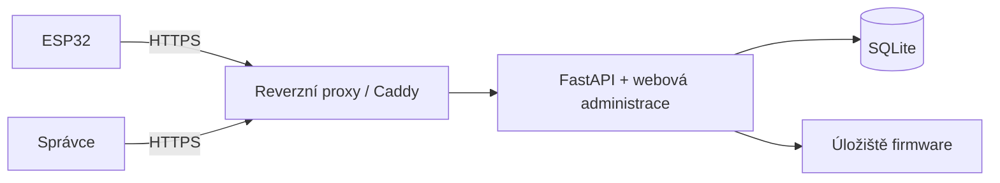

# Architektura a rozsah

## Cíl a předpoklady

MVP obslouží jednu instalaci a menší flotilu ESP32 přes Wi-Fi/HTTPS. Návrhový ověřovací profil je 100 zařízení s intervalem 15 minut, tedy 9 600 check-inů denně; nejde o deklarovaný výkonnostní limit. Součástí dodávky serveru je API a jednoduchá administrace. Firmware handler má vlastní implementaci podle [klientské smlouvy](esp32.md).

Server funguje nezávisle na službě pro měření. Zařízení provede krátký check-in během stejného probuzení. Budoucí integrace manifestu do odpovědi měřicí služby může použít stejnou rozhodovací vrstvu, ale není součástí MVP.

## Komponenty

API, administrace, streamování souborů a provozní CLI sdílejí aplikační služby. Databázové transakce nesmějí trvat po dobu uploadu ani downloadu. Aplikace neposílá příkazy spícímu zařízení a neudržuje trvalá klientská spojení.

## Rozhodování při check-inu

Po autentizaci a validaci server v krátké transakci:

1. Vyřeší duplicitu `request_id`, případně vrátí uloženou odpověď.
2. Uloží nový kontakt a pozorovanou identitu běžícího firmware.
3. Zpracuje přiložené OTA události a uloží jejich potvrzení.
4. Vyhodnotí jediné aktivní přiřazení zařízení: zrušení, dostupnost vydání, kompatibilitu, již běžící hash, blokované vydání, neuzavřený pokus a retry interval.
5. Je-li vše splněno, vytvoří nabídku obsahující nový `offer_id`; jinak uloží konkrétní důvod bez aktualizace.
6. Uloží výslednou odpověď pro idempotentní opakování a transakci potvrdí před odesláním HTTP odpovědi.

Server nabídku může dále odložit kvůli nahlášené baterii, pokud má zařízení nastavený práh. Konečné bezpečnostní rozhodnutí o energii vždy provádí firmware. Chybějící baterie při požadovaném prahu znamená odklad.

Důvody rozhodnutí: `no_assignment`, `offered`, `already_running`, `release_unavailable`, `incompatible`, `battery_low`, `battery_unknown`, `retry_backoff`, `attempt_active`, `attempt_result_unknown`, `release_blocked`, `assignment_cancelled`. Podrobnosti stavů jsou v [datovém modelu](data-and-states.md).

## Životní cyklus vydání

Upload obsahuje binárku a metadata produktu, hardwarové revize, cílového čipu, build čísla, verze, identifikátoru OTA layoutu a podpisového profilu. Server streamuje do dočasného souboru, omezuje velikost a vypočítá SHA-256 přes přesné poskytované bajty. Zkontroluje dostupnou kapacitu, formát aplikačního obrazu a metadata dosažitelná z image; neověřitelné údaje označí jako deklarované správcem.

Po flush/fsync se soubor atomicky přesune na stejném filesystemu do `firmware/<sha256>.bin`; adresář se synchronizuje tam, kde to OS podporuje. Následuje DB transakce vytvoření vydání `available`. DB nikdy nesmí odkazovat na nedokončený soubor. Pád mezi přesunem a DB commitem zanechá pouze dohledatelný osiřelý soubor.

Identita binárky a kompatibilita vydání jsou neměnné. Změna obsahu vyžaduje nové vydání/build. Poznámky lze upravit s auditem. Stažení z nabídky (`withdrawn`) zablokuje nové nabídky, starty a downloady; již přenesený firmware nelze vzdáleně odvolat. Historie i pozdní hlášení zůstávají přijímány. MVP nemá fyzické mazání vydání v administraci.

## Kompatibilita a přiřazení

Zařízení má registrací stanovený produkt, hardwarovou revizi, čip, OTA layout a podpisový profil. Check-in hlásí i aktuální kapacitu neaktivního slotu. Přiřazení i každý start musí projít kontrolou všech těchto údajů a velikosti.

Build je kladné rostoucí celé číslo v rámci produktu; verze je text pro člověka. Downgrade je v MVP zakázán. Rollback bootloaderem je lokální zotavení a tohoto zákazu se netýká. Nové vydání se nikdy nevolí automaticky jen proto, že má nejvyšší build.

Nové přiřazení vyžaduje explicitní zrušení starého. Zrušení nepřerušuje firmware, který již běží na zařízení; blokuje nové starty a downloady. Server nadále přijímá výsledky rozběhnutého pokusu a v historii je nesmí připsat novému přiřazení.

## Administrace

- Zařízení: registrace, zobrazení jednorázového tokenu, odvolání/výměna tokenu, přehled kontaktů, baterie, běžícího a potvrzeného vydání.
- Vydání: upload, metadata, hash, velikost, poznámky, stažení z nabídky.
- Nasazení: přiřazení jednomu zařízení, zrušení, zobrazení pokusů, vědomé odblokování dalšího pokusu.
- Historie: stránkovaná časová osa kontaktů, rozhodnutí, pozorování verzí a událostí, filtr podle zařízení/vydání/výsledku.

UI jasně rozlišuje „pozorovaná verze“, „potvrzená aktualizace“ a „výsledek neznámý“. Časy se zobrazují v nastavitelné zóně, výchozí `Europe/Prague`; ukládají se v UTC. Hromadná nasazení, procentní rollout a kanály jsou mimo MVP.

## Bezpečnost

- HTTPS s ověřením certifikátu a hostname na klientovi. Manifest má URL odvozenou z konfigurace `PUBLIC_BASE_URL`, nikdy z neověřené hlavičky Host.
- Náhodný 256bitový device token, uložený jen jako SHA-256 digest; token má dostatečnou entropii a není uživatelské heslo. Identita vychází z tokenu, nikoli z těla požadavku. Odvolání působí i na download.
- Jediný správce MVP: heslo hashované Argon2id, serverová session, cookie Secure/HttpOnly/SameSite=Lax, rotace session při přihlášení, CSRF ochrana všech změn. Heslo nastavuje interaktivní CLI, ne argument shellu.
- Správcovské API používá session a CSRF; device token ho neopravňuje. OpenAPI dokumentace administračních operací je dostupná jen správci.
- Limity těl, uploadu a souběžných přenosů; přiměřené rate limiting s `429` a `Retry-After`. Žádné tokeny v URL/logu, žádný dump Authorization nebo celých request bodies.
- Podepisování probíhá mimo server. Produkční firmware ověřuje podpis důvěryhodným klíčem; server distribuuje již podepsaný obraz beze změny. SHA-256 není náhrada podpisu. Konkrétní schéma a režie musí být zvoleny podle ESP frameworku před implementací klienta.
- Nahrávaná jména souborů se nikdy nepoužívají jako cesta. Historie je aplikačně append-only, není kryptograficky nezměnitelným auditem.

## Mimo rozsah MVP

Kompilace a podepisování firmware, OTA bootloaderu/partition table, delta aktualizace, download přes více probuzení, MQTT push, automatický downgrade, multitenancy, PostgreSQL a objektové úložiště. Není požadován Redis ani fronta úloh.

## Referenční dokumentace

- [FastAPI v kontejnerech](https://fastapi.tiangolo.com/deployment/docker/): vlastní image a procesní model.
- [SQLite WAL](https://www.sqlite.org/wal.html): lokální filesystem a jeden zapisovatel.
- [ESP-IDF HTTPS OTA](https://docs.espressif.com/projects/esp-idf/en/stable/esp32/api-reference/system/esp_https_ota.html): klientský transport a dokončení aktualizace.
