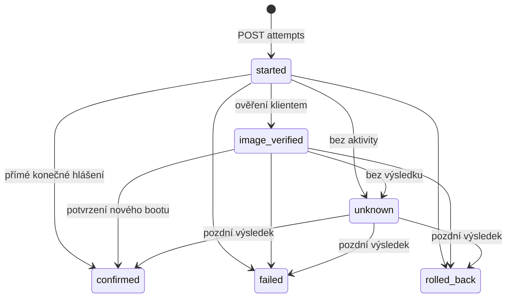

# Data, historie a OTA stavy

## Konvence a invarianty

SQLAlchemy modely mají Alembic migrace. SQLite zapíná `foreign_keys=ON`, `journal_mode=WAL`, `synchronous=FULL` a `busy_timeout=5000` ms na příslušných spojeních. ID jsou UUID v TEXT, velikosti/buildy INTEGER, UTC časy RFC 3339 TEXT v jednotném formátu. JSON se ukládá jako validovaný TEXT. Všechny změny doménového stavu a jejich audit probíhají v téže transakci.

- Jedno zařízení má nejvýše jedno aktivní přiřazení a jeden otevřený pokus; vynucují je částečné UNIQUE indexy, nejen kontrola v Pythonu.
- Release je unikátní podle `(product, build)`. Shodný artefakt může sdílet více release metadat; soubor je adresovaný hashem.
- `confirmed` nikdy nevznikne z HTTP downloadu, přítomnosti jiné verze ani timeoutu.
- Kontakty a události jsou append-only, výjimkou je řízená retenční údržba. Projekce zařízení/přiřazení/pokusu se aktualizují.
- Původní i cílový build a hash pokusu jsou snapshoty; historie nesmí záviset na budoucí změně konfigurace zařízení.
- Ztracená odpověď nesmí vytvářet další nabídku/pokus/událost při opakování téhož klíče v garantovaném okně.

## Tabulky

| Tabulka | Důležitá pole a vazby |
| --- | --- |
| `devices` | `id`, `name`, kompatibilita, `token_digest` UNIQUE nullable, `created_at`, `last_seen_at`, `observed_build`, `observed_artifact_sha256`, `last_confirmed_release_id`, `last_confirmed_at`, `battery_mv`, `rssi`, `min_ota_battery_mv` |
| `releases` | `id`, kompatibilita, `build`, `version`, `artifact_sha256`, `size`, `storage_key`, `notes`, `state` available/withdrawn, `created_at`, `withdrawn_at` |
| `deployments` | `id`, `device_id` FK, `release_id` FK, `control_state` active/cancelled/completed, `result_state`, `retry_generation`, `generation_started_at`, `created_at`, `cancelled_at`, `confirmed_at`, `reason` |
| `check_ins` | `id`, `device_id` FK, `request_id`, `received_at`, firmware/baterie/RSSI snapshot, `decision`, `deployment_id`, `offer_id` nullable; index `(device_id, received_at, id)` |
| `request_dedup` | `(device_id, request_id)` PK, digest normalizovaného těla, celá JSON odpověď, `created_at`, `expires_at`; neodkazuje na retenčně mazaný check-in |
| `offers` | `id`, `deployment_id` FK, `check_in_id` nullable, `created_at`, `expires_at`, snapshot manifestu; retence po expiraci viz níže |
| `ota_attempts` | `id` od klienta, `offer_id` FK, `device_id` FK, `deployment_id` FK, digest start požadavku, snapshot from/to, `retry_generation`, `status`, `started_at`, `last_activity_at`, `closed_at`, `max_sequence`, `error_code` |
| `ota_events` | `id` od klienta, `attempt_id` FK, `sequence`, digest normalizovaného obsahu, `status`, `running_firmware`, `occurred_at` nullable, `received_at`, `error_code`, omezená diagnostika |
| `download_requests` | `id`, `attempt_id` FK, `requested_at`, `finished_at` nullable, HTTP stav, předané bajty; nedokončený záznam po pádu zůstává neúplný |
| `firmware_observations` | `id`, `device_id` FK, `received_at`, předchozí a nová pozorovaná identita, zdrojový check-in; pouze při změně identity |
| `admin_audit` | `id`, správce, akce, objekt, `received_at`, bezpečný snapshot změny a důvod; bez tajemství |
| `admin_credentials`, `admin_sessions` | Jediný správce, Argon2id hash, serverové session s expirací; nepatří do historie zařízení |

Částečné indexy: `UNIQUE deployments(device_id) WHERE control_state='active'`; `UNIQUE ota_attempts(device_id) WHERE status IN ('started','image_verified')`. Události mají UNIQUE `(attempt_id, sequence)`. Vydání/pokusy/události se v MVP nemažou. FK historických dat používají RESTRICT, žádné kaskádové smazání zařízení/vydání. Pozorované identity mohou být neznámé serveru, proto nejsou povinným FK na release.

## Oddělené pojmy

**Přiřazení (deployment)** je správcův záměr instalovat vydání do jednoho zařízení. Má nezávislý řídicí stav a výsledek. Může být zrušené, a přesto později obdržet potvrzení již probíhajícího pokusu. Zrušení se tím neruší.

**Nabídka (offer)** je konkrétní manifest vrácený v check-inu. `offered` znamená „server připravil odpověď“, nikoli důkaz jejího doručení.

**Pokus (attempt)** začne až přijetím `POST /attempts`. Jeho `started` také neprokazuje přijetí odpovědi klientem. Jeden pokus může obsahovat více download requestů. Po restartu klient navazuje na uložené attempt UUID, nevymýšlí nový pokus pro stejný výsledek.

`deployments.result_state` je projekce s hodnotami `pending`, `offered`, `started`, `image_verified`, `confirmed`, `failed`, `rolled_back`, `unknown`. Bez pokusu vychází z existence nabídky; jinak z nejnovějšího pokusu podle serverového `started_at`. Potvrzení libovolného vlastního pokusu cílového vydání má přednost jako důkaz dosaženého výsledku, nepřepisuje však novější pozorování skutečně běžící verze. Čekání na retry a blokace jsou odvozená pole odpovědi/UI, nikoli další důkazové stavy.

## Stavový automat pokusu

`confirmed`, `failed`, `rolled_back` jsou klientské konečné výsledky a uzavírají pokus. `unknown` je uzavření serverem bez důkazu; nikoli klientská chyba ani úspěch. Pozdní konečný výsledek jej může doplnit. Samotná opožděná `image_verified` ho znovu neotevírá.

Události jsou očíslované klientem uvnitř pokusu. Server uloží i platný starší mezistav, ale nevrací projekci zpět. Klientská implementace musí konečnému výsledku přiřadit vyšší sequence než všem předchozím událostem. Nižší/stojné konfliktní sequence se stejným obsahem je duplicita, s jiným obsahem konflikt. Druhý odlišný konečný výsledek stejného pokusu se odmítá. Po již potvrzené aktualizaci je případný pozdější lokální zásah novým pozorováním, nikoli přepsáním uzavřeného výsledku.

Přijetí `confirmed` s cílovým buildem a hashem aktualizuje výsledek odpovídajícího přiřazení. Je-li stále aktivní, jeho `control_state` přejde na `completed`. U zrušeného přiřazení zůstane `cancelled` a doplní se výsledek. Neovlivňuje to jiné přiřazení.

`devices.observed_*` aktualizují pouze nové, neduplikované check-iny podle času přijetí. Zpožděná OTA událost nesmí přepsat aktuálně pozorovanou verzi. `last_confirmed_release_id` představuje poslední známé potvrzení podle pořadí `attempt.started_at`; opožděný výsledek staršího pokusu nepřepíše novější potvrzení. Žádný z těchto údajů nezaručuje stav zařízení právě teď.

## Odklady a opakování

Výchozí politika MVP, konfigurovatelná na instalaci:

- Nabídka vyprší za 10 minut; odklad kvůli energii nespotřebuje pokus.
- Otevřený pokus bez aktivity 30 minut přejde při dalším přístupu nebo údržbě na `unknown`; dokud se to neprovede, je stále blokující.
- `network_timeout`, `flash_write_failed` a `power_low` dovolují další pokus nejdříve za 6 hodin; maximálně 3 starty v retry generaci.
- Chybný hash, podpis, kompatibilita a `self_test_failed` blokují vydání pro dané přiřazení do ručního zásahu. Rollback i `unknown` také vyžadují zásah; server nesmí automaticky přepisovat zařízení s nejasným výsledkem.
- Správce může pomocí `retry` zvýšit retry generaci a povolit nový pokus, s povinným důvodem a auditem. Nové nabídky musí vzniknout po tomto zásahu. Počty a historie staré generace se nemažou.
- Ruční retry neukončuje otevřený pokus; nejprve je nutné vyčkat na výsledek/timeout. Pozdní událost staré generace nezruší povolení novější generace, ale může stále pravdivě doplnit výsledek starého pokusu.

Pokud check-in hlásí již cílový hash, server nenabídne nový download (`already_running`). Bez explicitní `confirmed` ale přiřazení neoznačí za úspěšné. UI vysvětlí „verze pozorována, potvrzení chybí“.

## Historie a retence

Každý autentizovaný validní check-in má vlastní logický záznam; síťová opakování stejného request UUID jsou v přístupovém logu, ale nevytvářejí další doménový kontakt ani neaktualizují pozorovanou verzi. Neautentizované a nevalidní požadavky se evidují jen v sanitizovaném přístupovém logu se stavem a trace ID.

- `check_ins`: výchozí 90 dní, nastavitelné; při 100 zařízeních přibližně 864 000 záznamů před indexy.
- `request_dedup`: 7 dní; po této době klient nesmí garantovat opakování stejného requestu.
- Nepoužité expirované nabídky: 90 dní; navázané na pokus zůstávají. Mazání check-inu nastaví `offers.check_in_id` na NULL.
- Vydání, přiřazení, pokusy, klientské události, downloady, změny verzí a správcovský audit: dlouhodobě, bez automatického mazání v MVP.
- Přístupové logy: 14 dní přes rotaci runtime/proxy.

Údržba maže po malých dávkách, nepoužívá pravidelný blokující VACUUM. Neexistující soubor referencovaného vydání se nikdy neřeší smazáním historie: vydání se označí jako provozně nedostupné a administrace hlásí poruchu.
