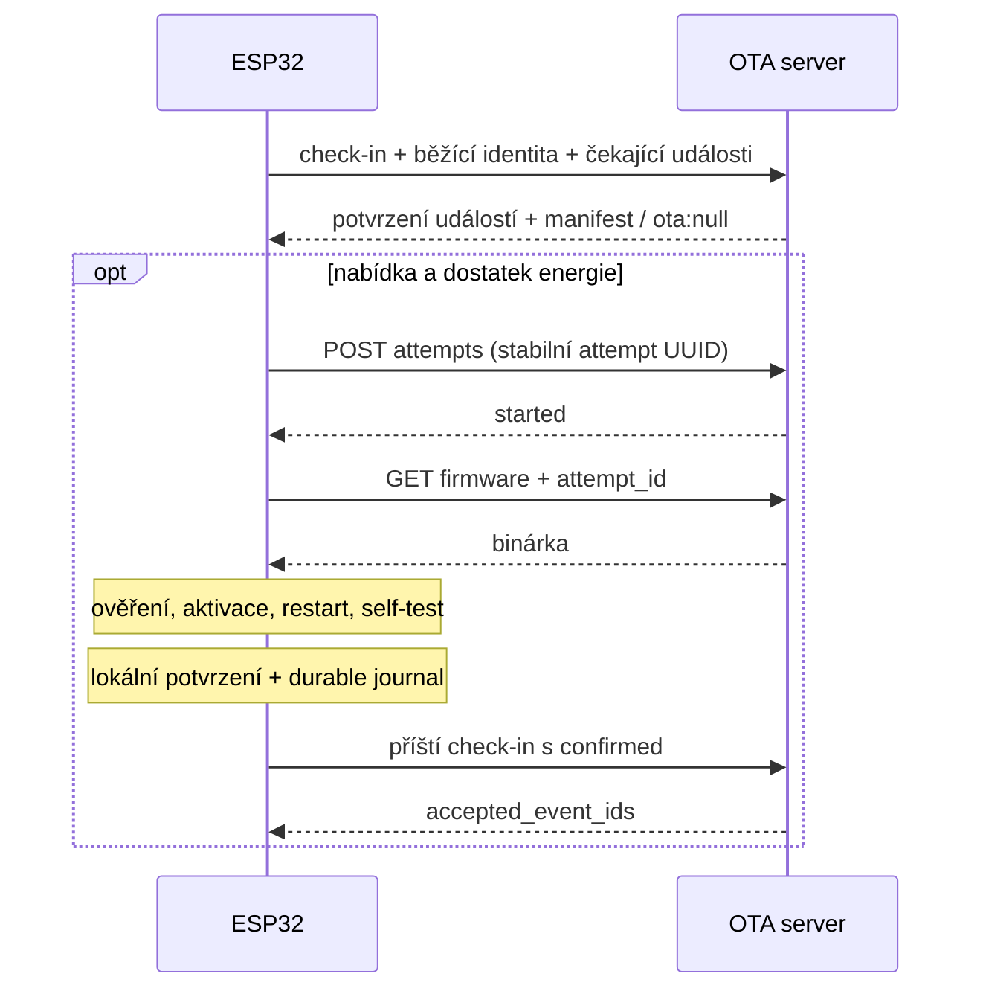

# Smlouva integrace ESP32

## Předpoklady před prvním OTA

Firmware i bootloader musí podporovat dva aplikační OTA sloty, `otadata`, rollback a aplikační potvrzení nové verze. Konkrétní partition table závisí na flash a velikosti obrazu. Pokud dnešní zařízení toto nemá, nejprve se připraví a nahraje odpovídající sestavení přes kabel. Běžná OTA tohoto projektu nemění bootloader, partition table ani datové oddíly.

Použitý ESP-IDF/Arduino core se před implementací připne. Pro IDF s volbou `CONFIG_BOOTLOADER_APP_ROLLBACK_ENABLE` ji zapnout; pokud daná verze odděluje režimy potvrzení, zvolit potvrzení aplikací, nikoli automaticky při startu. Ověření rollbacku je součást fyzické akceptace, nestačí kontrola makra v aplikačním kódu. [ESP-IDF OTA](https://docs.espressif.com/projects/esp-idf/en/stable/esp32/api-reference/system/ota.html)

## Běžný cyklus

1. Při startu zkontrolovat boot stav a rozpracovaný OTA journal ještě před běžným návratem do sleepu.
2. Při prvním startu nového obrazu provést krátký lokální self-test: konfigurace, klíčové periferie, inicializace síťového stacku. Chybějící externí server sám o sobě neznamená vadný firmware.
3. Při úspěchu potvrdit obraz bootloaderu a trvale zapsat událost `confirmed`; při selhání připravit rollback a uchovat informaci pro předchozí obraz.
4. Provést měření a odeslat jej stávající webové službě s timeoutem.
5. Provést OTA check-in s aktuální identitou a dosud nepotvrzenými událostmi. Chyba OTA služby nesmí blokovat měření.
6. Pokud přijde nabídka, ověřit kompatibilitu, kapacitu slotu, podpisový profil, lokálně blokovaná vydání a rezervu baterie. Stejný běžící hash znovu neinstalovat.
7. Zapsat attempt UUID a původní/cílovou identitu do NVS; přes `POST /attempts` zahájit pokus. Bez úspěšné odpovědi nestahovat.
8. Stáhnout přes HTTPS do neaktivního slotu, ověřit kompletnost, hash a podpis, zapsat journal a bezpečně aktivovat nový boot.
9. Restartovat. Pokud se OTA nekoná nebo selže, zavřít spojení a přejít do deep sleepu na 15 minut.

## Identita a NVS journal

Build a verze jsou součástí sestavení. SHA-256 distribuovaného artefaktu pochází z ověřeného manifestu; nelze jej prostě vložit do stejné binárky, jejíž celý hash se počítá. Při provisioning přes kabel se hash uloží do NVS samostatně.

Journal pro každý slot uchovává dvojici `{app_image_identity, artifact_sha256}`; `app_image_identity` je digest/identita běžícího obrazu dostupná z frameworku. Oba druhy hashů se nesmějí zaměňovat, zvlášť u podepsaného artefaktu. Při instalaci se cílový slot a jeho identita navážou na ověřený artefakt. Při bootu se identita porovná se skutečně běžícím obrazem a teprve pak se reportuje jeho artefakt hash. Neznámá/poškozená vazba vyžaduje servisní zotavení; zařízení nesmí hlásit cílový hash jen proto, že si ho pamatuje z nabídky.

Trvalý journal obsahuje attempt/offer/deployment/release UUID, původní i cílovou identitu, fázi, další sequence a malou frontu událostí. Retry generaci spravuje server; klient ji nemusí znát. Pro lokální blacklist stačí release ID a explicitní servisní odblokování. Zápisy jsou transakční nebo dvoukopiové s kontrolou konzistence.

Kritické pořadí: uložit `activation_pending` před přepnutím boot slotu; po restartu nejdříve vyhodnotit skutečně běžící slot a bootloader state. Pád mezi lokálním potvrzením obrazu a uložením `confirmed` musí jít při příštím bootu z journalu rekonstruovat. Stejně tak nesmí pád před samotnou aktivací vyvolat falešný rollback: pokud stále běží výchozí obraz, nejprve zkontrolovat očekávaný boot slot a stav cílového slotu; při neprokazatelném výsledku hlásit chybu/neurčitost, ne vymyšlený úspěch. `rolled_back` se hlásí až s důkazem odmítnutého cílového obrazu a běžící původní verze.

Událost vzniká nejprve v NVS, teprve potom se odesílá. Stejné UUID/sequence/obsah se opakuje až do přijetí v `accepted_event_ids`. Fronta drží alespoň 16 záznamů, koncové výsledky se nesmějí přepsat mezistavy. Pokud je plná, nezačínat další OTA. Starší firmware musí journal i NVS konfiguraci umět číst; nevratná migrace konfigurace nesmí znemožnit rollback.

Lokální blacklist po neplatném podpisu/hash nebo rollbacku blokuje release ID. Ruční retry na serveru samotné lokální blokaci nemusí stačit; MVP odblokování vyžaduje servis zařízení nebo nové opravené vydání s novým ID. UI na to musí správce upozornit.

## Energie, timeouty a transport

- Baterii měřit před startem a podle možností i během přenosu. Prah určit podle chemie, regulátoru a poklesu napětí při Wi-Fi. Neexistuje univerzální napětí vhodné pro všechny desky.
- Výchozí klientské limity pro ověření: Wi-Fi 15 s, běžný OTA request 5 s, výpadek přísunu dat 10 s, celková OTA 180 s. Nastavit podle měření skutečné instalace. Celkový limit zahrnuje zápis/ověření; watchdog se obsluhuje bez nekonečných čekání.
- Celá aktualizace probíhá v jednom probuzení. MVP nepokračuje rozpracovaným downloadem po deep sleepu.
- Použít ověřování TLS certifikátu/hostname a dostupný čas pro validaci certifikátu. Zajistit obnovu důvěryhodných CA při jejich změně; nikdy nepoužívat insecure klienta jako náhradu.
- GET se autentizuje stejným tokenem; nepřeposílat token redirectem na jiný host. MVP server redirecty pro firmware nevytváří.
- Produkční obraz je podepsaný a ověřený klientem před aktivací. SHA-256 se počítá nad přesnými bajty distribuovaného souboru.

V ESP-IDF použít pokročilé `esp_https_ota_begin/perform/finish` pro hlídání timeoutů a přerušení. Zohlednit, že `finish` již přepíná boot partition; dodatečné vlastní ověření hashe až po `finish` by bylo pozdě. Použít dostupný hook/ověření streamu před finalizací, nebo nižší `esp_ota_*` API. Arduino implementace musí poskytovat stejné garance, i pokud používá `Update` místo IDF wrapperu. [HTTPS OTA API](https://docs.espressif.com/projects/esp-idf/en/stable/esp32/api-reference/system/esp_https_ota.html)

## Co potvrzení znamená

`confirmed` znamená, že zařízení lokálně ověřilo funkčnost nové aplikace a zrušilo bootloader rollback. Server pouze přijal toto tvrzení autentizovaného klienta; nejedná se o vzdálenou atestaci ani záruku budoucí dostupnosti. Selhání sítě po potvrzení může jeho doručení odložit o libovolný počet cyklů.
